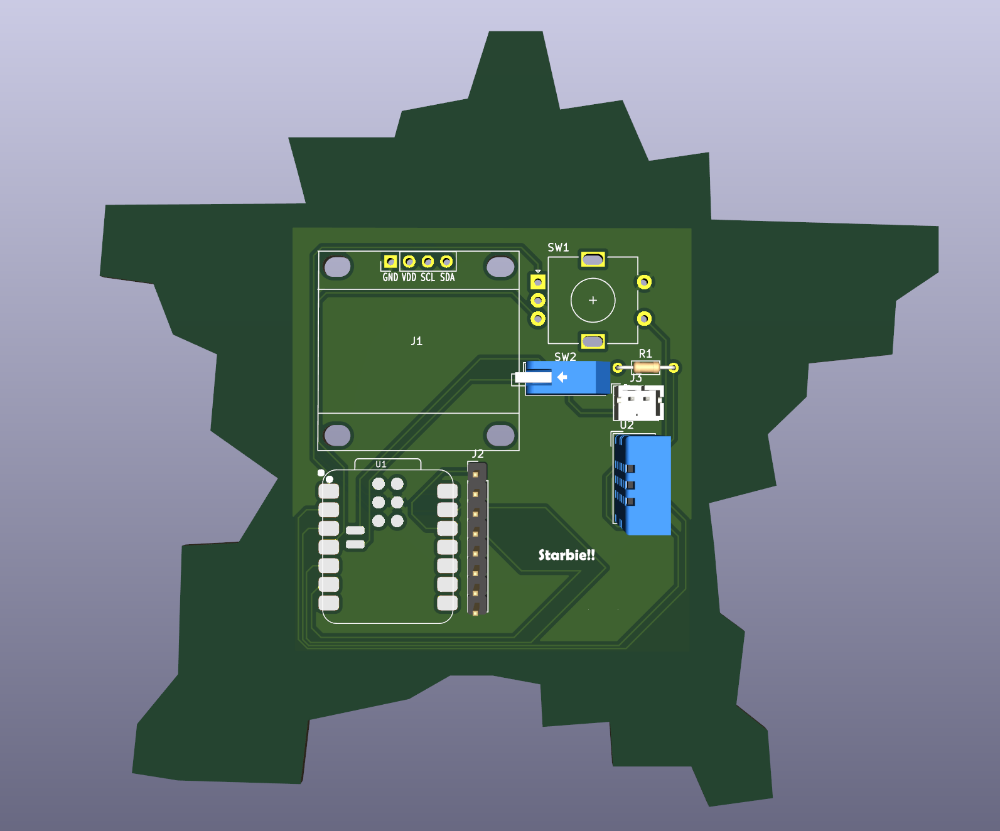

# Starbie

Starbie is a tiny, digital pet. It is basically a merge of a Tamagotchi and a Starboy!
Made for Half Life from Hackclub (Check it out!!!)

## How it works

It uses an environmental sensor and an mpu to process motion and temperature. 
It can display a cute animation on a small oled screen. 
You can also use the rotary encoder to change animations!
AND ITS BATTERY POWERED!!!

### Reference

This was based on the starter project from the half life event. This is the [link](https://github.com/SharKingStudios/Starbie) to the repository of the original.
